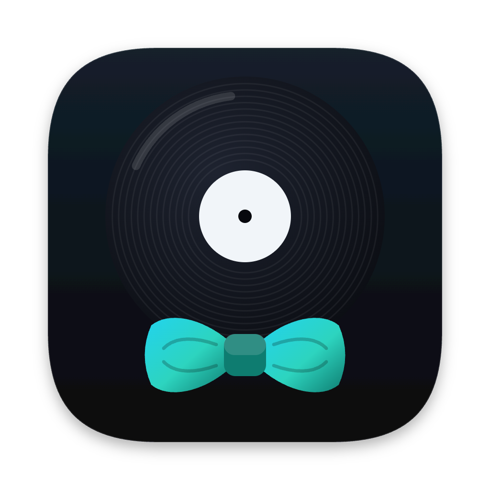

# Track Livery



A small Mac app that dresses your music downloads in their best before they go into
Apple's Music app. Drop a track you bought as a download onto its window or Dock icon,
or let it watch your Downloads folder, and it:

1. converts **WAV, AIFF or FLAC** to **Apple Lossless** with macOS's own encoder:
   bit-identical audio, same bit depth and sample rate. **MP3 and AAC** keep their
   format and audio untouched and only get tags and cover art;
2. finds the **cover art**: first the cover already inside the file, then the
   official cover in the `artwork` folder some stores put beside their downloads,
   and only then online (iTunes Search and MusicBrainz / Cover Art Archive; the
   larger image wins);
3. sets the **genre** (one for the whole batch, or one per track), carries over
   the file's own tags (album, year, track number, comment, BPM), and tidies titles
   and albums written in ALL CAPS or all lowercase (artist names are never changed);
4. **adds the track to your Music library**;
5. optionally moves the original download to a **backup folder** you choose.

## Download

Get the latest version from the [Releases page](https://github.com/Alexis1537/track-livery/releases).
Open the DMG and drag Track Livery into Applications. It is signed with a Developer ID
and notarised by Apple, so it opens without warnings, and it updates itself: it checks
once a day and asks before installing anything (or choose **Track Livery → Check for
Updates…**).

Requires macOS 14 or later. Nothing else to install.

The first time, macOS asks whether Track Livery may control **Music** (to add tracks)
and, if you turn watching on, read your **Downloads** folder. Click **Allow**.

## What it will never do

- **It never deletes anything from your Music library.** If a track with the same title
  and artist is already there, it is left alone and the app says so.
- **It never loses a download.** If the backup folder is missing or full, nothing is
  moved or binned; the file stays where it is and the app tells you why. A file Music
  plays from directly is never moved.

## Privacy

Your music never leaves your Mac. When a track has no cover of its own and none sits
beside it, the app sends the track's **artist and title** (and nothing else) to
Apple's iTunes Search and to MusicBrainz to find one. You can turn that off in
**Settings → Covers**. Update checks contact GitHub, where the app is published; no
information about your Mac or your music is sent with them.

## Build it yourself

```sh
SIGN_IDENTITY=- ./build.sh     # build/TrackLivery.app, signed only for this Mac
open build/TrackLivery.app
```

Without `SIGN_IDENTITY=-`, `build.sh` signs with the maintainer's Developer ID
certificate; `make-dmg.sh` builds the installer (it needs
[dmgbuild](https://github.com/dmgbuild/dmgbuild): `pip install dmgbuild`) and, with
`NOTARY_PROFILE` set, notarises it.

| File | What it does |
|---|---|
| `Sources/Pipeline.swift` | the steps in order: read tags, convert (or keep MP3/AAC), cover art, tag, add to Music |
| `Sources/Converter.swift` | WAV / AIFF / FLAC to Apple Lossless with AudioToolbox |
| `Sources/SourceTags.swift` | reads the tags already in the file |
| `Sources/Tagger.swift` | writes tags and cover art into .m4a files with AVFoundation |
| `Sources/ID3Writer.swift` | writes MP3 tags and cover art, keeping the other tags |
| `Sources/ArtworkFetcher.swift` | cover-art lookup |
| `Sources/MusicImporter.swift` | adds the file to the Music library (never deletes) |
| `Sources/FolderWatcher.swift` | watches the downloads folder (FSEvents) |
| `Sources/DropWindow.swift` | the window |
| `Sources/TrackList.swift` | the track list with a genre menu per track |
| `Sources/Settings.swift` | stored settings and the Settings window |
| `Sources/TitleCase.swift` | the tidy-capitals rule |
| `Tests/SafetyChecks.swift` | checks that damaged cover images and tags are refused safely |

## Licence and credits

MIT licence: see [LICENSE](LICENSE). Credits for the visual ideas and for Sparkle,
the update framework, are in [NOTICE](NOTICE).

"Beatport" and other store names are trade marks of their owners; Track Livery is
not affiliated with or endorsed by any music store.
